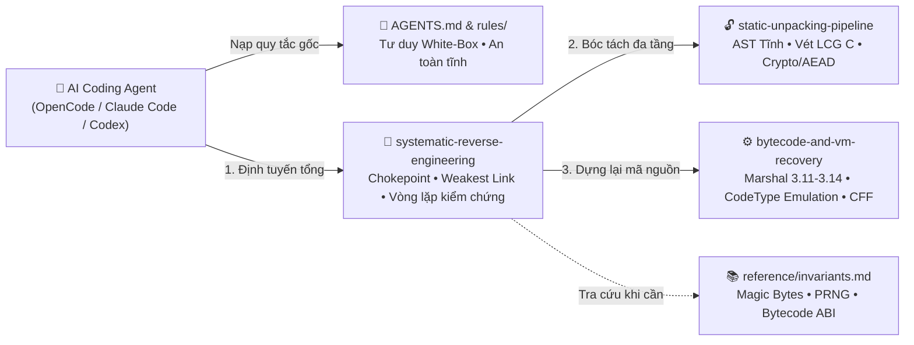

<div align="center">

# ⚡ Novoid Decompiler System

**Hệ thống Quy tắc, Tư duy Dịch ngược Hệ thống và Bộ Skill AI chuyên dụng để phân tích mã làm rối đa tầng, Custom VM và bytecode Python phức tạp.**

[](skills/)
[](rules/)
[](AGENTS.md)
[](LICENSE)

</div>

---

## 🏗️ Kiến trúc Hệ thống Skill



* **Tư duy cốt lõi (`rules/mindset.md`):** Chuẩn hóa 6 trụ cột dịch ngược có hệ thống — nguyên lý *White-Box*, tách *Data vs. Mechanism*, tìm *Execution Chokepoint*, bám *Invariants & Weakest Links*, vòng lặp *Hypothesis → Experiment → Verify*, và *Static-First*.
* **Ràng buộc an toàn (`rules/safety-and-boundaries.md`):** Cấm chạy `exec`/`eval` trên payload lạ, cách ly artifact trung gian, cấm bịa đặt logic khi khôi phục mã nguồn và bắt buộc kiểm chứng checksum/AEAD ở mọi tầng.
* **Kiến trúc Skill nạp theo ngữ cảnh (`skills/`):** Thiết kế theo chuẩn *Progressive Disclosure* — chỉ giữ mô tả kích hoạt ngắn gọn trong ngữ cảnh thường trực, nạp chi tiết kỹ thuật và bảng hằng số (`invariants.md`) đúng thời điểm cần thiết.

---

## 📂 Cấu trúc Repository

```text
novoid-decompiler-system/
├── AGENTS.md                                  # Điểm vào & bảng định tuyến quy tắc/skill cho AI Agent
├── README.md                                  # Tài liệu tổng quan hệ thống
├── LICENSE                                    # Giấy phép MIT
├── .gitignore
├── rules/
│   ├── mindset.md                             # 6 trụ cột tư duy dịch ngược hệ thống
│   └── safety-and-boundaries.md               # Quy tắc an toàn thực thi tĩnh & chống bịa đặt mã nguồn
└── skills/
    ├── systematic-reverse-engineering/        # Skill điều phối tổng quy trình dịch ngược hệ thống
    │   ├── SKILL.md
    │   └── reference/
    │       └── invariants.md                  # Bảng tra magic bytes, hằng số PRNG/hash, CPython ABI
    ├── static-unpacking-pipeline/             # Skill bóc tách lớp mã hóa tĩnh & bẻ seed LCG/AEAD
    │   └── SKILL.md
    └── bytecode-and-vm-recovery/              # Skill đọc Marshal đa phiên bản, CodeType động & CFF
        └── SKILL.md
```

---

## 🎯 Danh mục Quy tắc & Skills

### Hệ thống Rules (`rules/`)

| Tệp | Trọng tâm | Vai trò đối với AI Agent |
| :--- | :--- | :--- |
| `AGENTS.md` | Chỉ mục & Nguyên tắc toàn cục | Định tuyến Agent đọc đúng rule và kích hoạt đúng skill theo ngữ cảnh |
| `rules/mindset.md` | 6 trụ cột tư duy dịch ngược | Ngăn Agent đọc chay mã rối; ép lần theo Chokepoint và điểm yếu toán học |
| `rules/safety-and-boundaries.md` | Ranh giới an toàn & Kiểm chứng | Ngăn chạy nhầm bẫy anti-debug/malware; ép kiểm tra CRC32/AEAD và AST |

### Hệ thống Skills (`skills/`)

| Skill ID | Nhiệm vụ chuyên biệt | Khi nào tự kích hoạt |
| :--- | :--- | :--- |
| `systematic-reverse-engineering` | Điều phối quy trình 6 bước từ phân tích lớp vỏ tới tái tạo logic | Gặp obfuscator lạ nhiều tầng, Custom VM hoặc bẫy chống dịch tĩnh |
| `static-unpacking-pipeline` | Trích hằng số bằng AST, phá LCG bằng C (`gcc -O3`), giải AEAD/HKDF | Gặp loader mã hóa nhiều lớp (`a85`/`b85`, XOR, LCG, C-stub nhúng) |
| `bytecode-and-vm-recovery` | Viết `MarshalParser`, mô phỏng `CodeType` builder, gỡ CFF & bẫy `0/0` | Gặp bytecode khác phiên bản (`3.11–3.14`), tag pool ngẫu nhiên, CFF |

---

## 🚀 Cài đặt & Tích hợp vào AI Agent

1. **Clone repository:**
   ```bash
   git clone https://github.com/hanovoid/novoid-decompiler-system.git
   ```

2. **Tích hợp vào Project (khuyên dùng cho OpenCode / Codex / Claude Code):**
   Copy thư mục `skills/*` vào `.agents/skills/` và tham chiếu `rules/` trong `AGENTS.md` của workspace:
   ```bash
   mkdir -p .agents/skills
   cp -r novoid-decompiler-system/skills/* .agents/skills/
   cp -r novoid-decompiler-system/rules ./rules
   ```

3. **Hoặc cài đặt toàn cục cho tất cả workspace:**
   ```bash
   mkdir -p ~/.agents/skills
   cp -r novoid-decompiler-system/skills/* ~/.agents/skills/
   ```

---

## ⚙️ Nguyên tắc vận hành cốt lõi

| Nguyên tắc | Hành vi bắt buộc của Agent | Mục đích |
| :--- | :--- | :--- |
| **Static-First** | Dùng `ast.literal_eval`, `ast.parse` và mô phỏng stack cục bộ | Không kích hoạt bẫy `os._exit`, xóa file, hay watchdog thread |
| **Chokepoint-Driven** | Truy thẳng tới `PyEval_EvalCode`, `CodeType`, VM loop rồi lần ngược | Bỏ qua 95% dữ liệu rác và chuỗi đánh lạc hướng |
| **Invariant Anchoring** | Bám vào header nén (`0x78`), hằng số LCG/Xorshift, stdlib ABI | Miễn nhiễm với đổi tên biến Unicode, emoji và random tag mỗi lần build |
| **Zero Fabrication** | Mọi dòng code khôi phục phải truy vết được về bytecode / pool thật | Đảm bảo đầu ra trung thực 100%, không suy đoán logic |
